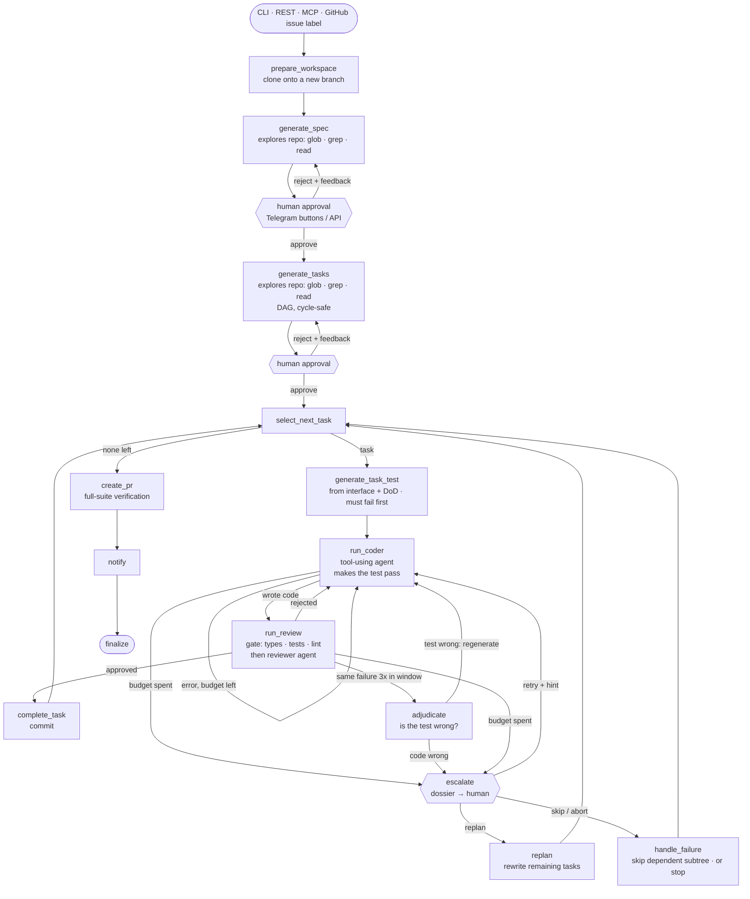

# agentflow

A multi-agent coding workflow built on **LangGraph**. You give it a feature request (CLI, REST, MCP, or a labelled GitHub issue). It writes a spec and a task plan and waits for a human to approve both. Then it implements each task against a target test: an acceptance test is written from the task's interface and Definition of Done and must fail first, a coder agent makes it pass, a deterministic gate runs, and a reviewer agent checks the result. A repository without a test suite of its own gets no target test; its own checks (types, build, lint) are the gate. Finally it opens a pull request. Agents read the target repository the way a developer does, with read-only **glob, grep and read tools**; there is no index and no embeddings.

It runs a whole workflow end to end: it calls tools, recovers from failures, pauses for people, and ships a PR. It is not a chat wrapper.



## How the vacancy requirements map to code

| Requirement | Where |
|---|---|
| **Python backend** | FastAPI (`api/app.py`), arq worker (`worker.py`), Pydantic everywhere, mypy-clean |
| **LLM APIs, agentic systems** | Anthropic (Opus/Sonnet) and DeepSeek via LangChain; `create_agent` coder and reviewer (`agents/`) |
| **LangGraph / LangChain** | 17-node `StateGraph` with typed reducers and runtime-context DI (`graph/`) |
| **Tool calling, structured outputs** | Read-only code navigation (glob/grep/read, `agents/repo_tools.py`) for the orchestrator, coder and reviewer; coder write tools; Pydantic outputs for spec, plan, review and referee (`schemas.py`), the orchestrator's returned through a structured-output tool at the end of exploration |
| **Context management** | No whole-repo dumps and no retrieval preload: agents pull in only what they grep and read; tool output is capped (100 grep matches, 400 lines per read) and every agent has a model-call ceiling. Language rules come from the gate, role craft from `skills/`, so no prompt carries another language's rules |
| **State** | Postgres checkpointer: per-run state, resumable after a worker restart |
| **Routing, retries, fallback** | Conditional edges (`graph/routing.py`); node `RetryPolicy` + timeouts; `.with_fallbacks()` on structured calls; `ModelFallbackMiddleware`, `ModelRetryMiddleware` and `ModelCallLimitMiddleware` on agents |
| **Recovery from failure** | Separate budgets, windowed stall detection (catches A↔B oscillation), a referee that can rewrite an unsatisfiable test, then escalation: a human picks retry-with-hint, re-plan, skip or abort |
| **API integrations, event-driven** | GitHub webhook (issue labelled → run → PR that closes it), Telegram inline buttons resume paused runs, Redis job queue |
| **Human-in-the-loop** | `interrupt()` at spec, plan, and whenever a task exhausts its budget (with an evidence dossier); answered via Telegram, REST, MCP or CLI; resumes deduplicated by checkpoint id |
| **MCP** | `mcp_server.py`: `create_task` and `list_board` (task board), `start_run`, `list_runs`, `get_run`, `review_checkpoint`, `resolve_failed_task`, plus repo selection over a whitelist (`list_repos`, `inspect_repo`, `find_repos`) |
| **Conversational layer** | `chat/`: a separate package on the Claude Agent SDK with a Telegram bridge; picks the repo from your criteria, confirms in code, talks to agentflow only through MCP |
| **Evaluation** | `evals/`: spec LLM-as-judge, e2e agent runs; all logged to LangSmith |
| **Tracing** | LangSmith traces tagged by role and task; OpenTelemetry spans and token metrics per board stage (`telemetry.py`), durable `stage_runs` in Postgres; JSON logs |
| **Docker, CI** | Multi-stage Dockerfile, docker-compose for the whole service; GitHub Actions CI |

## Quickstart

```bash
cp .env.example .env            # ANTHROPIC_API_KEY, DEEPSEEK_API_KEY at minimum
uv sync

# Full run in-process on a local repo: approve spec and plan in the terminal, commits land locally
uv run agentflow run "Add a change_email service that rejects duplicates" --path ../some-python-repo
```

### As a service

```bash
docker compose up -d            # postgres, redis, api, worker
curl -X POST localhost:8010/runs -H 'content-type: application/json' \
     -d '{"prompt": "Add order history endpoint", "repo": "you/your-repo"}'
curl localhost:8010/runs                                   # in-flight runs: waiting on you first, then stalled ones
curl localhost:8010/runs/<thread_id>                       # status, spec, tasks, pending approval
curl -X POST localhost:8010/runs/<thread_id>/approval \
     -H 'content-type: application/json' -d '{"approved": true}'
```

Outside docker-compose every secret is required: an empty `API_TOKEN` answers 503, and an empty
`GITHUB_WEBHOOK_SECRET` / `TELEGRAM_WEBHOOK_SECRET` rejects the webhook. Compose sets `INSECURE_DEV=true`
and binds its ports to 127.0.0.1, which is the only setup where checks may be skipped. `local_path`
(run the agent in a directory of the API host) is accepted only in that mode, and Telegram commands are
honoured only from `TELEGRAM_CHAT_ID`.

You can also wire up these triggers:

- **GitHub webhook** → `POST /webhooks/github` (event: issues). Labelling an issue `agentflow` starts a run; the PR body says `Closes #N`.
- **Telegram** → `POST /webhooks/telegram` with `TELEGRAM_MODE=webhook` (needs a public HTTPS URL), or `TELEGRAM_MODE=polling`, where the api pulls updates itself; docker-compose defaults to polling, because on a laptop Telegram has nowhere to deliver a button press. The worker posts the spec or plan with ✅/❌ buttons, and `/reject <thread> <feedback>` rejects with feedback. When a task runs out of budget, it posts the dossier with 🔁 Retry / 🗺 Re-plan / ⏭ Skip / 🛑 Stop buttons; `/hint <thread> <guidance>` retries with guidance. A pressed question loses its buttons and says who answered; each worker job keeps one silent status card up to date (phase, current step, tasks), edited at most every few seconds; `/status [thread]` reports a run on demand (no thread = the latest one); `/runs` lists every in-flight run, whoever started it, with the ones waiting on you first, then stalled ones (🧟) with their cause (`/runs all` adds finished ones); errors arrive verbatim in a code block.
- **Failed task via REST** → `POST /runs/<thread_id>/decision` with `{"action": "retry" | "replan" | "skip" | "abort", "hint": "..."}`.
- **MCP**: `uv run agentflow-mcp` (stdio) or `--http` (127.0.0.1:8001; every request needs `Authorization: Bearer $MCP_TOKEN`, and an empty token refuses to start unless `INSECURE_DEV=true`). `ecosystem.config.js` runs it and the chat layer under pm2. Add it to Claude Desktop or Claude Code to start and approve runs from chat; `list_runs` there shows the same in-flight list as `/runs`, so a run started from Telegram can be approved from a Code session and the other way round.
- **Chat in plain language**: [`chat/`](chat/README.md) is a second Telegram bot on the Claude Agent SDK over the same MCP server. «найди репозиторий на Python с fastapi, активным CI и лицензией MIT и добавь туда эндпоинт X» → `find_repos` → «Запустить в X?» → `start_run`.

**Repo whitelist.** Runs started over MCP may only target repos listed in `repos.toml` (`REPOS_FILE`; copy
`repos.example.toml`). A model that guessed a repo name could otherwise push to anything the GitHub token
reaches. `docker compose` bind-mounts `./repos.toml` into `api` and `worker` (the file is gitignored, so the image has none: the containerised intake refused every card until it was mounted) and refuses to start without it. With no whitelist, `start_run` with a repo is refused unless `INSECURE_DEV=true`. `inspect_repo`
reads facts from the GitHub API without cloning (README, topics, languages, dependencies from manifests,
layout, workflows and the latest CI result, last commit, open PRs, license, CONTRIBUTING, push permission;
cached 10 minutes). `find_repos` checks hard criteria against each one and reports passed / failed /
unknown, where unknown means the fact couldn't be fetched. Topic fit is left to the caller's model,
which reads the description and README.

**Task board.** Tasks are moving to a GitHub Projects board where every task is an issue and each column is a stage with its own agent (Бэклог → Планируется → Делается → Тестируется → Готово к мержу → Смержено, plus Блокировка). `board.py` is the only way in: it reads columns, lets an agent claim a card through the Owner field, and moves a card only along the allowed transitions — one column forward, back to Делается from testing or review, into Блокировка from any working column. Each move first posts the stage's report as an issue comment (with a machine-readable `agentflow:report` line) and only then changes Status, so a card never lands in a new column without its explanation; the third return to Делается blocks the card instead of looping. MCP `create_task` opens an issue from the template (goal, Definition of Done checklist, context) in a whitelisted repo and puts it in Бэклог; `list_board` shows the cards. The board lives in an organization because user-owned projects get no `projects_v2_item` webhooks and fine-grained tokens can't reach them; it uses its own `GITHUB_BOARD_TOKEN`, `BOARD_ORG`, `BOARD_PROJECT`. `scripts/setup_board.py` creates the columns and fields (the field is `Task type`: GitHub reserves `Type`). The first stage agent is **intake** (`stages/intake.py`, skill `skills/intake/intake.md`), the agent of Бэклог: a model reads the issue and the author's answers and extracts type, goal, Definition of Done and priority; code then decides. A complete card is rewritten to the template (keeping its reply address) and moved to Планируется; a missing goal or DoD, an uncheckable DoD item ("works fast") or an unsure type becomes numbered questions in a comment, and the card waits in Бэклог until the author answers; a type with no workflow, a repo outside the whitelist or a duplicate of an open card goes to Блокировка with the reason, as does a third unanswered round. Intake asks what is wanted, never how to build it: in the eval it first asked for response codes and paths on 6 of 10 complete prompts, which the planner reads from the repo. `uv run python -m agentflow.stages.intake` processes the free cards once. **planner** (`stages/planner.py`), the agent of Планируется, explores a throwaway clone of the repo and writes the spec and task plan exactly as the orchestrator does in a standalone run, from the card alone. The plan goes onto the card as one comment: readable for a person, with the spec and tasks base64-encoded in an `agentflow:plan` marker (raw JSON would end the HTML comment at the first `--`). Unless the card's `Approval` is `none` (unset counts as needing approval), the card waits: a comment «ок» approves the plan, anything else is feedback and the plan is rewritten from the previous version with it; a third rejected version goes to Блокировка. On approval every task becomes a sub-issue of the card (sub-issues a dead pass already filed are found by their `agentflow:subtask` marker, not filed twice) and the card moves to Делается. **developer** (`stages/developer.py`), the agent of Делается, runs the approved plan through the developer graph (`build_developer_graph`): the same task loop — acceptance test, coder, gate, review, referee, escalation — without the spec and plan nodes, ending in `push_branch`, which runs the full suite and pushes `agentflow/issue-<N>-<id>`; the PR is a later column's job. The run's thread id goes into the card's `Run` field. Every task done and the suite green → Тестируется with the branch link, and the finished tasks' sub-issues are closed. A task out of budget pauses the run and the card goes to Блокировка with the dossier; a person answers in a comment (a hint for a retry, «пропусти», «перепланируй» or «стоп») and moves the card back, and the paused run resumes with that answer rather than starting over. A failed task or a red suite also blocks. A run whose worker died continues from its checkpoint. `uv run python -m agentflow.stages.planner` / `…stages.developer` process their columns once; the code ↔ gate ↔ review loop stays one graph inside Делается because it runs 5–10 iterations per task, each of which through the board would be a GitHub write and a fresh agent. **tester** (`stages/tester.py`, skill `skills/tester/testing.md`), the agent of Тестируется, clones the card's branch and checks each Definition of Done item without the developer's history: behaviour gets a test it writes and runs itself (one file per item under `tests/dod/`, never committed), a fact about the repository gets an inspection with a file:line quote as evidence; then the whole suite runs. Every item proven and the suite green → Готово к мержу with the checklist; anything else → back to Делается with what failed. A card sent back gets a **fix run**: one task, «fix what the report found», on the card's own branch with the report as its description, instead of the whole plan again from main. **releaser** (`stages/releaser.py`), the agent of Готово к мержу, opens the PR (the tester's checklist, `Closes #N`) and watches it: red CI → back to Делается with the failing checks, running CI → wait, green (or no CI) → merged once a person writes «мержи» on the card, or at once for a repo with `auto_merge = true` in the whitelist; a conflict or a PR closed unmerged → Блокировка. On Смержено the releaser closes the card's remaining sub-issues: a fix run has tasks of its own, so a live card was merged with its plan's sub-task still open. Reports carry the card's branch in their machine line (`branch=`), so each stage finds it on the card. Stage git operations on the board organization's repos use `GITHUB_BOARD_TOKEN` (`config.token_for`): a live clone of the org's sandbox failed with 401 under `GITHUB_TOKEN`. The developer puts back files the coder wrote that the plan gives to a later task (a live run's first task rewrote the second task's file, whose test then passed before its code). Closed issues left in a column are not cards to work on. After a worker is killed mid-coder, the resumed coder often finds nothing left to change; edits already on disk in the task's files count as that attempt's work instead of a failed attempt.

**Orchestrator** (`orchestrator_pm.py`), an arq cron in the worker once a minute, runs the board and does no task work. It hands each free card to a `stage_job` itself, writing the agent into Owner before queueing, so two agents never take one card (the claim-and-read-back could race). Each launch gets its own arq job id: arq keeps a finished job's result for a day and silently refuses an id it still holds, so with one id per card a card back in a column the same day was never run again. Cards go by priority within WIP limits (Делается 4, Планируется 2, Тестируется 2), one card per repo in Делается, and nothing new leaves Бэклог while more than three cards wait on a person. A job keeps a heartbeat key per card; an agent's name in Owner without one means the job died, and the card is freed with a comment (the second time it goes to Блокировка), within three minutes of the kill. A card that ended a pass waiting for a person's words is not re-run until its issue changes. An LLM provider error no retry fixes (no credit, a bad key) opens a 30-minute breaker with one Telegram message; nothing starts while it is open. A card leaving Бэклог gets its Approval: research and text `none`, at most two DoD items and not high priority `plan_only`, else `full`. A daily Telegram summary lists the columns and what is blocked. The `agentflow` label adds the issue to Бэклог when a board is configured (without one it still starts a run), and the chat bot files cards with `create_task` instead of starting runs. `uv run python -m agentflow.orchestrator_pm` prints what one tick would do.

A card's `Blocked reason` field keeps the first line of the report (up to 300 characters): GitHub refused a developer's whole dossier for the text field after the card had already moved.

**Stage telemetry** (`telemetry.py`). Every stage job is an OpenTelemetry span `stage <agent>` (card, repo, column, attempts, outcome, LLM calls and tokens) and a row in Postgres `stage_runs`; every model call adds its tokens to the running stage through a LangChain callback and to the `agentflow.llm.tokens` counter. Compose runs `grafana/otel-lgtm` as `otel`: Grafana on http://localhost:3300 (Explore → Tempo, `{name=~"stage.*"}`), OTLP on `localhost:4318` for the projects the board builds. LGTM keeps days, so the measure → spec loop reads `stage_runs`, which keeps everything: `uv run python scripts/telemetry_report.py --repo <owner/name> --days 7` prints per-stage p50/p90, errors and tokens, and per-card lead time and returns. A failed telemetry write is logged and never fails the stage. The exporters are off unless `OTEL_EXPORTER_OTLP_ENDPOINT` is set; tests pass no database, so they leave no rows.

**Research cards** (`stages/research.py`, skill `skills/researcher/research.md`, after the hub's research playbook) go through the same columns with each stage's craft swapped: the planner writes a search plan (queries, what counts as worth keeping, how many) instead of a spec, and research needs no approval; the developer column runs a researcher, an agent with `web_search` and `fetch_url` (DuckDuckGo's HTML endpoint: the model's own server-side search answers "credit balance is too low" through cursor-proxy), and code writes one file per finding into `LIBRARY_REPO`'s `inbox/` by the library's contract, drops URLs the library already has (no `utm_*`, no anchor), and commits `research: <topic> (+N)`; the tester checks each file's contract fields and name, that its link opens, that its URL is in the library once, and each DoD item against the files. Passed → Смержено directly (research has no PR; the board allows Тестируется → Смержено) and the issue is closed; anything else goes back to the researcher with the report. A batch with nothing new goes to Блокировка rather than to a tester with nothing to check.

**GitHub token.** `GITHUB_TOKEN` needs Contents and Pull requests read/write on the whitelisted repos
(Issues too for the label trigger); a fine-grained token limited to those repos is the safe choice. Git
gets it from a credential helper set in the environment of each clone and push, for github.com only. It
is never written into the workspace's `.git/config`, and the agents' file tools refuse `.git/` outright:
`read_file` could otherwise put the token into the model's context and traces. In docker-compose a
`GITHUB_TOKEN` in the shell overrides `.env` (e.g. `GITHUB_TOKEN=$(gh auth token) docker compose up -d`).
Commits are by the token's owner, under their GitHub noreply address (`<id>+<login>@users.noreply.github.com`),
so GitHub and Vercel can tie them to the account; with no identity, git used `user@<container id>` and
Vercel refused to deploy. `GIT_AUTHOR_*` / `GIT_COMMITTER_*` in the environment override it.

## Design notes

**Agents explore; there is no RAG.** The project used to run hybrid RAG: code-aware chunks, Voyage embeddings, pgvector + Postgres full-text fused with RRF, and a 6000-token preload in every coder prompt. It was removed after measuring it on this repo: the preload put the target files in context in only 2–3 of 6 tasks (README and generated guide data took the rest), and in a live run the coder never called its search tool, going straight to `read_file`. A plan has to name exact target files and binding interfaces, which means following references: find the file, grep every call site, read the module it extends. So the orchestrator (`generate_spec`, `generate_tasks`, `replan`) runs as a `create_agent` with read-only `glob_files`, `grep` and `read_file` (`agents/repo_tools.py`, sandboxed to the workspace, output capped) and returns its `SpecDraft`/`TaskPlan` through a structured-output tool. The coder gets `glob_files` and `grep` next to its own read/write tools, the reviewer gets all three. Exploration is capped at 20 model calls; if it ends without an answer or errors, the orchestrator falls back to a one-shot structured call, so a tool loop can't fail the run at planning. Dropping RAG also dropped the embeddings provider, pgvector and the re-index after every task.

**Role skills: the craft, not the language.** Each role's system prompt says what the call must produce and the contract around it (binding interface, Definition of Done, structured output). How a good engineer in that role works lives apart, in `src/agentflow/skills/<role>/<name>.md`: planning for the orchestrator (mirror the closest existing feature, cut by behaviour, riskiest part first), test design for the test generator (public interface, exact assertions, boundary inputs, mock only process boundaries), implementation for the coder (read before write, smallest diff, fail loudly), review for the reviewer (correctness before style, grep every caller, security is always blocking), independent testing for the board's tester (one check per Definition of Done item, run code before reading it, quote evidence, never fix). Skills are language-agnostic on purpose, and a test enforces it: pytest and vitest rules depend on how the gate runs tests, so they stay in `gate/`. Skills are inlined into every call of the role rather than fetched by a tool, because they always apply, and a coder once given an optional search tool never called it. Edit a skill by editing its Markdown; a new file in a role's folder is picked up with no code change. **Cross-project engineering rules** — SOLID, OOP, clean code — live once in the hub (`hub/engineering/*.md`), not here, so people and every project's agents read one copy. `HUB_ENGINEERING_DIR` points at that directory; each file names its roles in front matter (`roles: orchestrator, coder, reviewer`), and `role_section` appends it after the role's own skills: the planner cuts tasks by responsibility, the coder writes to the rules, and the reviewer holds changes to them, blocking only on breaks that cost later (logic in a view, an invariant set around its owner, a hard-wired external dependency, a copied business rule, a speculative abstraction) and noting taste as suggestions. Compose mounts `~/code/hub/engineering` (or `$HUB_DIR/engineering`) into the worker; a configured directory without skills stops the worker at start, and the start log lists which hub skills each role got. Prompts are built at import, so a hub edit takes effect on the next worker start.

**One Postgres, one role.** It holds LangGraph checkpoints, so a paused or interrupted run resumes where it stopped. Plain Postgres 17, no extensions.

**What was cut and why.** The project used to ship a Terraform stack (VPC, EKS, RDS, ElastiCache) with a Helm chart and a CD workflow, Prometheus metrics, and cross-run "lessons" in the LangGraph Store. The AWS stack was never applied: CD skipped every run, and it would cost about $300 a month to host one worker that `docker compose` runs on a single VM. Prometheus had nothing to scrape it without a cluster, and LangSmith already traces what matters for agents (stage-level OpenTelemetry came back later with a single-container LGTM stack, which needs no cluster). Lessons lost their point when embeddings went: recall returned the newest review comments whatever the task, which is noise in the coder's prompt.

**Failure handling is the product.** This is a port of a TypeScript version that ran on real repos. Every rule in `graph/nodes.py` and `gate/` has a comment naming the failure it prevents. Some examples:

- The gate owns its own vitest config, because the coder kept narrowing `include` until no tests ran.
- A malformed reviewer response does not count against the task.
- A test that contradicts its own task is detected and rewritten instead of burning the whole budget.

**Target tests, not TDD.** Every task in the plan carries a binding `interface`: module path, signatures, exceptions. Its acceptance test — the target — is written *before* the code by a different agent, from that interface and the Definition of Done, and must fail first (red check). A test that already passes asserts nothing, so it is regenerated once. The coder then sees an executable target from its first attempt. Unlike TDD there are no small red/green/refactor cycles and the test is not a design tool; it is the task's stop condition, written by someone other than the implementer so it cannot mirror the code. A target test only lands in a PR when the repository tests itself (a test framework, a real `test` script, or test files): on a project without a suite the gate checks types, `npm run build` (skipped if it was already broken before the run) and lint, and the reviewer judges the diff against the Definition of Done.

The original TypeScript version wrote tests first too, but without a fixed interface the test generator invented names (`addNote` where the spec said `add`) and deadlocked the coder. That led to a test-after mode, where the generator sees the code first. Test-after avoids the deadlock but biases tests toward whatever the code already does. Fixing names in the plan removes the deadlock without giving up independent tests, so test-after was removed. The referee still catches a test that contradicts its task.

**Stalled runs say why.** A run whose worker went away used to keep its last status ("coding") forever, with nothing anywhere saying it had stopped. Now the worker holds a Redis heartbeat (`agentflow:running:<thread>`, 2-minute TTL) while it drives a run, and a run that is neither finished nor paused but has no heartbeat is shown as stalled in `/runs`, `/status`, `GET /runs` and MCP `list_runs`/`get_run`. Its `cause` comes from the checkpoint: the run's recorded error, else the exception LangGraph kept for the node that was running (a dead process still leaves it there), else "worker stopped without recording an error" with the node it was about to run. A cancelled job (worker restart, arq job timeout) is recorded as failed with `Run cancelled: …`; `CancelledError` is not an `Exception`, so the crash handler used to miss it.

**Escalation, not silent skipping.** When a task runs out of budget, the run pauses with an `interrupt()`. Previously it marked the task failed and quietly skipped everything that depended on it. Now a human gets a dossier:

- the attempts per budget;
- the distinct recent failures;
- the open reviewer requests;
- the files written so far;
- what would be blocked;
- the branch holding the partial work.

The human then chooses one of four actions:

- **retry**: budgets reset, and the hint goes into the coder's prompt as top-priority guidance;
- **re-plan**: a replanner rewrites only the not-yet-done tasks around the failure and gives them fresh ids, so no per-task state leaks in; completed work is untouched;
- **skip**: the old behaviour; the task's dependents are skipped too;
- **abort**: the run stops.

Unattended runs keep the old behaviour with `on_task_failure="skip"`. Each task can escalate at most `max_escalations_per_task` times, and a run can re-plan at most `max_replans` times.

This follows how production harnesses treat budget exhaustion: stop and escalate with the evidence, rather than "try harder" or drop work silently. Stall detection counts a failure's repeats over a window rather than only back-to-back, the way OpenHands' stuck detector also catches alternating patterns. The first live test-first run failed exactly that way: the test failed, the reviewer rejected the fix, and the cycle repeated.

**Gate per language.** `gate/` detects the target repo's language: Python gets pytest + ruff + mypy (or compileall); TypeScript gets tsc + vitest + eslint. The TS gate brings its own test runner (vitest, jsdom, Testing Library, pinned in `gate/js_runner/package.json`, installed into `JS_RUNNER_DIR`, preinstalled in the Docker image). Its config lives outside the repo and is layered over the project's vite config (path aliases and plugins still apply), so a React site without tests still gets component tests (`.test.tsx`, `render(<Home />)`) run, and the repo's `package.json` is never touched for the gate's sake; a repo with its own vitest uses it. Dependencies install with `npm ci`, so the lockfile only changes when the task changes dependencies. A Python repo managed by uv (a `uv.lock` or `[dependency-groups]`) is installed with `uv sync --all-groups` into the gate's venv, not `pip install -e .`: that skipped dependency groups (a Django app's django-stubs, so mypy could not load its plugin) and refused an app that is not a package (a flat `apps/ config/ tests/` layout). Each gate reports the reason a check failed, not just the test name. It also never fails on conditions the coder can't fix, such as a scaffolding task with no sources yet.

## Evals

```bash
uv run python -m evals.spec_eval      # LLM-as-judge: testable / grounded / scoped
uv run python -m evals.e2e_eval       # real models on the fixture repo: completion rate, gate/review cycles
uv run python -m evals.intake_eval    # intake on 10 real prompts: right type, questions for vague ones, reject out of scope
```

The spec eval lets the orchestrator explore the fixture repo with its tools and gives the judge the whole (small) repo to check grounding against. The retrieval eval was removed together with RAG.

## Interactive guide

`guide/` is a small React app that explains the project. It replays a real run step by step, gives each concept something to try (routing simulator, HITL), lists the use cases, and tells the stories of the bugs found live. Start it with `cd guide && pnpm install && pnpm dev`.

## Live run

`scripts/live_smoke.py` drives the dockerised service end to end: `POST /runs` → approve spec → approve plan → wait.
A run on a private sandbox repo (Opus via an OpenAI-compatible proxy for orchestrator/tests/review, DeepSeek as coder)
planned two dependent tasks, passed the gate and review on the first attempt for both, and opened a PR with both
acceptance tests committed — 160 s wall time.

Getting there surfaced seven bugs the offline suite could not see, each now covered by a test:
- the workspace volume was root-owned
- linting the whole repo failed tasks on files the coder may not edit
- uncapped reviewer malfunctions looped forever when the API balance ran out
- DeepSeek's `thinking` flag must travel in `extra_body`
- a tool `name` kwarg broke the whole OpenAI-compatible fallback branch
- `ChatAnthropic` ignored keys from `.env`
- crashed runs had no terminal status

`pytest -m live` now makes one structured call per configured model *in isolation*, because a fallback chain
hides a broken fallback until the day the primary goes down.

Claude can be reached directly (`claude-*` model names, `ANTHROPIC_API_KEY`) or through an OpenAI-compatible proxy
(`cpx*` names, `CLAUDE_PROXY_URL` / `CLAUDE_PROXY_KEY`).

### Claude through cursor-proxy

The orchestrator (spec, plan, replan, PR description), the test generator and the reviewer (including the referee)
default to `cpxopus`: Opus through the local
[cursor-proxy](https://github.com/gavrilovdm/cursor-proxy), the same setup vacancy-parser uses. The proxy takes
OpenAI-format requests and forwards them to Anthropic with the Claude Code OAuth session, so no Anthropic key is needed.

One proxy per machine serves every project; this repo carries no proxy code.

```bash
cd ~/cursor-proxy
node dist/cli.js status               # version must be ≥ 0.2.0, loggedIn true
node dist/cli.js import-claude-code   # if loggedIn is false
node dist/cli.js install-service      # macOS launch agent on 127.0.0.1:8787
node dist/cli.js key                  # prints the cpx_… key once → CLAUDE_PROXY_KEY in .env
node dist/cli.js update               # later: pull, rebuild, restart
```

docker-compose reaches it at `host.docker.internal:8787`. `cpx*` models are a plain `ChatOpenAI`: from 0.2.0 the proxy itself moves `system` text into the first user
turn (the OAuth upstream ignores it silently), drops `temperature` for Opus and drops empty text blocks — see its README.
**An older proxy silently drops every agent's system prompt**, so check `curl 127.0.0.1:8787/healthz` after setting up.

The proxy picks up Claude Code's session from the Keychain on its own; if requests fail with `login_required`, start
Claude Code or re-run `import-claude-code`.
Requests are billed as Claude Code traffic on a personal session — fine for manual runs, a deliberate choice for anything scheduled.

## Development

```bash
uv run pytest                        # 57 tests: gate, repo tools, routing, API/webhooks, whole-graph e2e (LLMs faked)
docker compose up -d postgres && uv run pytest -m integration   # paused run resumed from Postgres
uv run pytest -m live                # one real structured call per configured model (costs money)
uv run ruff check . && uv run mypy src
cd guide && pnpm test && pnpm build  # routing parity with graph/, graph layout sync, render
```

CI runs all of these except `-m live`, plus a Docker build.

The graph e2e tests use real git and a real Python gate, with fake LLM agents. They cover:

- spec rejection and revision
- a gate failure fed back to the coder
- a stall that reaches the referee
- skipping the dependent subtree after a failure
- a review rejection that costs one cycle
- a paused run resumed from Postgres after a restart (`-m integration`)

## Layout

```
src/agentflow/
  agents/        orchestrator · test_generator · coder · reviewer (+ referee) · repo_tools (glob/grep/read)
  graph/         state · context (DI) · nodes · routing · build
  gate/          python · typescript · detection
  skills/        language-agnostic craft per role: intake · orchestrator · test_generator · coder · reviewer · tester (+ hub/engineering via HUB_ENGINEERING_DIR)
  stages/        board stage agents: intake · planner · developer · tester · releaser
  integrations/  workspace (git) · github · telegram
  api/ worker.py mcp_server.py repos.py cli.py runner.py progress.py observability.py telemetry.py board.py orchestrator_pm.py
chat/   separate package: Claude Agent SDK session per chat + Telegram bridge, MCP-only
evals/  tests/  docker/  .github/workflows/
```
